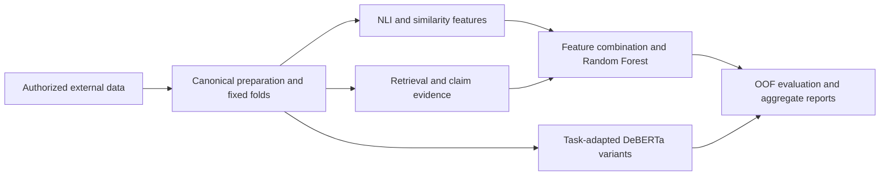

# SHROOM Hallucination Detection

A thesis implementation studying how natural-language inference, semantic similarity, retrieved evidence and task adaptation can identify hallucinations in generated text. The work uses the SemEval 2024 SHROOM setting across definition modeling, machine translation and paraphrase generation.

The project covers **E1–E11**, including unsuccessful variants, with implementation code, protocols and recorded evaluation evidence. Exact replay requires separately obtained datasets, model weights and frozen artifacts.

## Technical work represented here

- Canonical preprocessing, fixed development folds, feature checks and out-of-fold evaluation.
- A 14-feature NLI/similarity Random Forest baseline and controlled evidence-feature extensions.
- RAG Modules 1–4: exact and hybrid retrieval, external lexical evidence, leakage controls and provenance checks.
- NLI, BERTScore and HHEM evaluators; claim decomposition with MiniCheck and FactCG integrations.
- MPNet artifact/provenance verification and static regression tests.
- Task-adapted DeBERTa, teacher-label feasibility analysis and contrastive variants, including failed attempts.

These are capabilities represented in the repository, not a claim that upstream models, libraries or every line of code were authored by one person.

**Stack:** Python, PyTorch, Hugging Face Transformers/tokenizers, scikit-learn, NumPy/pandas/SciPy, notebooks and experiment-specific runtime specifications. Historical remote experiment scripts use Modal; release preparation does not launch compute.

## Methodology

| Stage | Research focus |
|---|---|
| E1–E3 | NLI, semantic similarity and their combined Random Forest baseline |
| E4 | Synthetic-data augmentation and ablation diagnostics |
| E5 | RAG Modules 1–4 and evidence acquisition/evaluation |
| E6 v1–v4 | Direct evidence features and model/runtime compatibility |
| E7 | Selective agentic routing |
| E8 | Nested Random Forest tuning |
| E9 | Claim-level verification and feature combinations |
| E10 | Selected FactCG combination; separate retrospective test reconstruction |
| E11 A–E | Task adaptation, teacher supervision feasibility and contrastive training |

See the [experiment index](docs/EXPERIMENTS.md) and protocols beside each implementation. E11-B produced no final student model or final metrics. Historical variants remain available as research evidence.

## Development results

These results use the **561-example canonical development evaluation**, not the official test set. The earlier 499-example notebook evaluation is a different population.

| Experiment | Correct / N | Accuracy | Spearman |
|---|---:|---:|---:|
| E3 canonical baseline | 445/561 | 0.793226 | 0.739040 |
| E6-v3 | 474/561 | 0.844920 | 0.781695 |
| E9-B | 468/561 | 0.834225 | 0.788580 |
| E10 | 475/561 | 0.846702 | 0.782809 |
| E11-C | 466/561 | 0.830660 | 0.727018 |

E10 was selected under the recorded accuracy-first rule; E9-B has higher Spearman correlation. E10 adds one correct decision over E6-v3. The recorded paired comparison has McNemar p=1.0 and a bootstrap accuracy-difference interval spanning zero; this is not a statistically established improvement.

Sources: [E10 metrics](RAG/results/phase3_e9_claim_verification/evaluation/E10/E10_metrics.json), [E9-B metrics](RAG/results/phase3_e9_claim_verification/evaluation/E9-B_metrics.json) and [full results](docs/RESULTS.md).

## Retrospective official-test reconstruction

A separate retrospective reconstruction on the labeled official test set records **1,234/1,500 correct**, **accuracy 0.8227** and **Spearman 0.7501**. This was not an official SemEval submission or competition ranking. It must not be described as prospective held-out validation of the entire research process.

See the [recorded test metrics](RAG/results/e10_official_test_v1/reconstructed_v1/E10_OFFICIAL_TEST_METRICS.json) and [limitations](docs/KNOWN_LIMITATIONS.md).

## Architecture



## Repository map

- `codex/`: canonical preprocessing, feature extraction, fixed folds and aggregate evaluation evidence.
- `RAG/`: original notebooks, RAG Modules 1–4 and experiments E6–E11.
- `solution/`: independent baseline/training implementation, kept at its original relative path and without its internal `.git` directory.
- `docs/`: experiment index, architecture, results, reproducibility and limitations.
- `data/`: selected historical notebooks and aggregate summaries, not a dataset distribution.
- `historical_versions/`: reviewed source snapshots, not standalone runnable checkouts.
- `manifests/`: file hashes, external-artifact inventory, historical decisions and transformations.

Paths are intentionally preserved because scripts use relative paths and frozen source hashes. Start with [architecture](docs/ARCHITECTURE.md), [experiments](docs/EXPERIMENTS.md), [results](docs/RESULTS.md) and [reproducibility](docs/REPRODUCIBILITY.md). Historical audit documents are retained for traceability but are not the primary project guide.

## Quickstart: choose an implementation

No universal environment reproduces every experiment. The independent `solution/` CLI provides an example entry point; it is **not** an end-to-end reproduction of the canonical thesis results. From an obtained source checkout, using Bash:

```bash
python -m venv .venv
source .venv/bin/activate
cd solution
python -m pip install -r requirements.txt
python -m src.main --help
```

Installation requires network access and compatible Python/PyTorch packages. Requirements are broad rather than a validated universal lockfile. These are documented usage commands, not a setup executed during release preparation. On Windows, use the appropriate PowerShell virtual-environment activation command.

Continue with the [solution quickstart](solution/QUICKSTART.md) for synthetic example data and CLI usage. Training and evaluation require models and may download weights; tiny examples do not establish SHROOM performance. For research runs, use the [environment matrix](docs/ENVIRONMENTS.md), experiment-specific protocols and [data access](docs/DATA_ACCESS.md).

## Reproducibility limitations

- Full datasets, checkpoints, environments, caches and row-level outputs are external.
- The public fold-ID projection does not replace the full canonical input schema.
- Frozen features, retrieval snapshots and model revisions are required for exact replay.
- Module 3 closed as a diagnostic stage; a standalone final gated-RAG implementation was not located.
- An original E8 report script retains a documented syntax defect; its separately named corrected renderer is included.
- Historical scripts are not a supported turnkey deployment or production service.

See [known limitations](docs/KNOWN_LIMITATIONS.md) and [reproducibility](docs/REPRODUCIBILITY.md).

## Licensing

Project-owned material that Spyros Kontakis is entitled to license is available under the [MIT License](LICENSE), copyright (c) 2026 Spyros Kontakis. Third-party code retains its own licenses and copyright notices; datasets and model weights are excluded from this grant. See [licensing scope](docs/LICENSE_PROPOSAL.md) and [third-party notices](docs/THIRD_PARTY_NOTICES.md).
